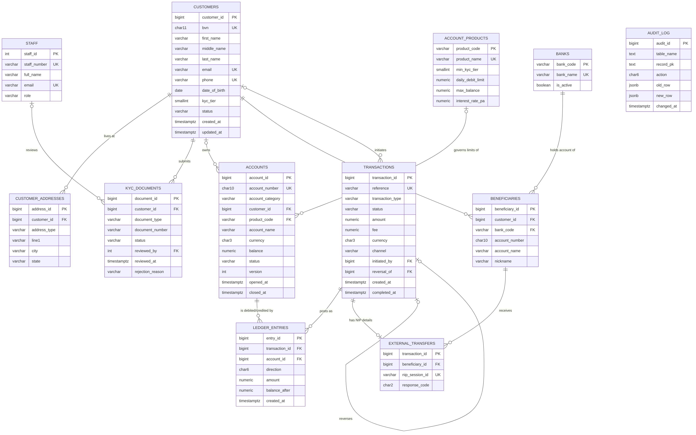

# Portfolio 1 — Database Design and Modelling

**Case study:** PayHaven, a simulated Nigerian digital bank and payments platform. See [docs/case-study.md](docs/case-study.md).
**DBMS:** PostgreSQL 16

## What's in this folder

| Path | Contents |
|---|---|
| `docs/case-study.md` | Organisation, users, data stored, key operations |
| `diagrams/er-diagram.mmd` | ER diagram source (Mermaid; GitHub renders it, see below) |
| `diagrams/er-diagram.png` / `.svg` | Rendered ER diagram |
| `docs/normalisation.md` | UNF → 1NF → 2NF → 3NF → BCNF walkthrough and controlled denormalisation |
| `sql/01_schema.sql` | Tables, primary/foreign/unique keys, CHECK constraints, indexes |
| `sql/02_functions_triggers.sql` | Cross-row/cross-table business rules (R1–R7) as triggers |
| `sql/03_views.sql` | Reconciliation, customer-accounts and statement views |
| `sql/04_seed.sql` | Fictional sample data (6 customers, 10 accounts, 12 transactions, 25 ledger lines) |
| `tests/constraint_tests.sql` | 30 automated tests proving the constraints reject bad data and accept good data |
| `evidence/` | Captured output: build + test results, data checks, constraint catalogue |
| `run_all.sh` | Rebuilds the database and runs the tests |

## ER diagram



**Entities (12):** customers, customer_addresses, kyc_documents, staff, account_products, accounts, banks, beneficiaries, transactions, ledger_entries, external_transfers, audit_log.

**Key relationships**
- A customer **owns** 0..N accounts. System (GL) accounts have no owner.
- An account product **governs** the limits of 0..N accounts.
- A transaction **posts as** 2..N ledger entries (double entry). Each entry hits exactly one account.
- A transaction **has** 0..1 external-transfer record (a 1:1 subtype for NIP details).
- A transaction **reverses** at most one other transaction (a recursive 1:1 relationship).
- A staff member **reviews** 0..N KYC documents.

## Keys

| Kind | Where | Why |
|---|---|---|
| **Surrogate PKs** (`GENERATED ALWAYS AS IDENTITY`) | customers, accounts, transactions, ledger_entries … | Stable, compact, never change even if business data does |
| **Natural PKs** | `banks.bank_code`, `account_products.product_code` | Short, stable, externally assigned codes |
| **Alternate (candidate) keys, UNIQUE** | `bvn`, `phone`, `lower(email)`, `account_number`, `reference`, `nip_session_id`, `(document_type, document_number)` | Enforce real-world uniqueness. `reference` doubles as an **idempotency key**, so a retried app request can't create a second transfer |
| **Composite unique keys** | `(customer_id, bank_code, account_number)` on beneficiaries, `(customer_id, address_type)` on addresses | No duplicate payees, one address per type |
| **Foreign keys** | 13 FKs, mostly `ON DELETE RESTRICT` for financial data, `CASCADE` only for dependent detail (addresses, KYC docs, beneficiaries) | You can't delete a customer who has money history |

## Constraints

**Declarative (CHECK)**: BVN is 11 digits, phone is `+234…`, customer is 18+, KYC tier is 1–3, statuses come from fixed lists, amount > 0, no overdraft on customer wallets, system accounts have no owner, `status = CLOSED ⇔ closed_at` is set, only REVERSAL rows reference another transaction, reviewed KYC documents must name a reviewer, rejected ones must give a reason.

**Trigger-enforced (rules that span rows or tables)**

| Rule | Description |
|---|---|
| R1 | `updated_at` is maintained automatically |
| R2 | An account's product must match the customer's KYC tier, and its balance must not exceed the product's `max_balance` (CBN tier limits) |
| R3 | Ledger line currency must equal transaction currency, and FROZEN or CLOSED accounts can't be posted to |
| R4 | **Double entry:** debits = credits for every transaction (a `DEFERRABLE INITIALLY DEFERRED` constraint trigger, checked at COMMIT) |
| R5 | The ledger is **append-only**: UPDATE and DELETE are blocked, and corrections are made with a REVERSAL |
| R6 | A reversal must target a SUCCESSFUL, non-reversal transaction and refund amount + fee exactly |
| R7 | Audit trail: before/after JSON of every change to customers, accounts and transactions |

The full constraint list, pulled from `pg_constraint`, is in [evidence/03_constraint_catalogue.txt](evidence/03_constraint_catalogue.txt).

## Normalisation

The schema is in **BCNF**. The full derivation from a flat operations spreadsheet, and the three deliberate denormalisations (`balance`, `balance_after`, `account_name`) with their safeguards, are in [docs/normalisation.md](docs/normalisation.md).

## How to run

```bash
# from the repository root
docker compose up -d                  # starts PostgreSQL 16 on localhost:5432
cd portfolio-1-database-design
PGPASSWORD=postgres ./run_all.sh      # builds schema, loads seed, runs 30 tests
```

Without Docker, point the `PGHOST`, `PGPORT`, `PGUSER` and `PGDATABASE` environment variables at any PostgreSQL 16 server and create a `payhaven` database first.

## Test results

```
 passed | failed | total
--------+--------+-------
     30 |      0 |    30
```
Full output: [evidence/01_build_and_constraint_tests.txt](evidence/01_build_and_constraint_tests.txt).
Every account reconciles, with stored balance = ledger balance and total debits = total credits: [evidence/02_seed_data_checks.txt](evidence/02_seed_data_checks.txt).

## Design decisions worth noting

1. **Double-entry ledger instead of `from_account`/`to_account` columns.** A fee-bearing transfer touches three accounts and a reversal touches them again. Ledger lines model that without NULLs and make every naira traceable.
2. **System (GL) accounts live in the same `accounts` table**, distinguished by `account_category`. That way every ledger line has a real FK target, and the whole ledger sums to zero.
3. **Money is `NUMERIC(18,2)`, never `FLOAT`**, which avoids rounding errors such as 0.1 + 0.2 ≠ 0.3.
4. **`version` column on accounts.** It's reserved for optimistic concurrency control in Portfolio 3.
5. **Failed transfers keep their transaction row but have no ledger lines.** That leaves support an audit trail without any money moving.
