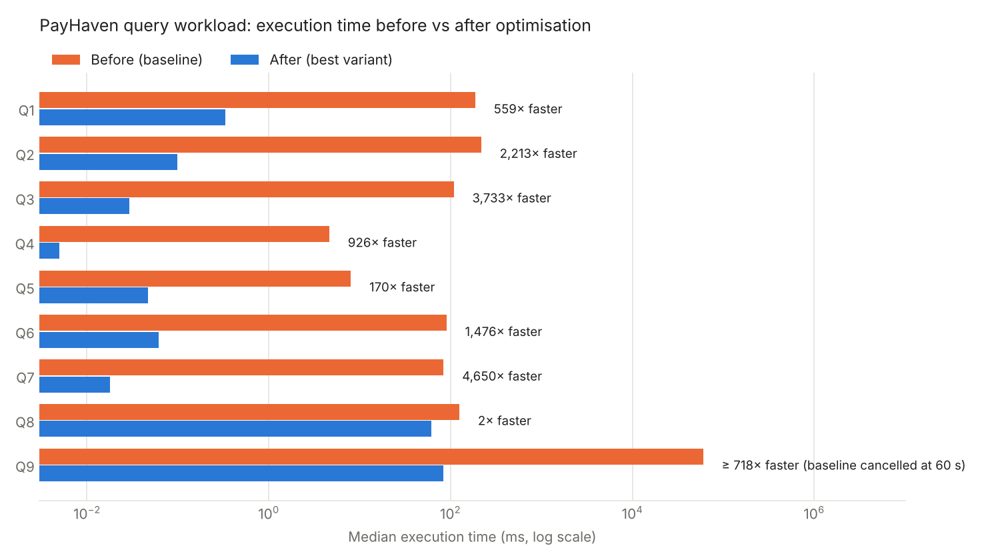

# Portfolio 2 — Query Processing and Optimisation

**Case study:** PayHaven (see Portfolio 1). **DBMS:** PostgreSQL 16, default configuration (`shared_buffers = 128MB`, `work_mem = 4MB`).

This portfolio takes nine real PayHaven queries, measures them on a realistic data volume, reads their execution plans, and optimises them with indexes, query rewrites and a materialized view. Every number in this README comes from `benchmark.py` and can be reproduced.



## 1. Test data

`sql/01_generate_bulk_data.sql` loads a reproducible dataset (`setseed`) on top of the Portfolio 1 schema:

| Table | Rows |
|---|---:|
| customers | 100,006 |
| accounts | 115,010 |
| transactions | 1,072,709 |
| ledger_entries | 2,397,806 (505 MB with indexes) |
| external_transfers | 269,480 |

The data is deliberately **skewed**, as real fintech data is. A few high-tier customers generate most of the activity: the median account has 10 ledger lines, the 99th percentile has 77, and the busiest customer account has 21,463. Skew is what makes the planner's job hard (see Q2).

**Bulk-load technique:** secondary indexes are dropped before the load and rebuilt afterwards, and triggers are disabled for the load transaction (`session_replication_role = replica`). Because skipping triggers is risky, the script then re-verifies every integrity rule. All violation counts are 0 (see `evidence/01_bulk_load_output.txt`).

## 2. Method

`benchmark.py` does the following:
1. Resets the database to a **baseline**, keeping only the indexes behind PRIMARY KEY and UNIQUE constraints (`sql/00_reset_baseline.sql`).
2. Runs each query once to warm the cache, then runs `EXPLAIN (ANALYZE, BUFFERS)` five times and records the **median** execution time.
3. Applies `sql/02_optimise.sql` and repeats step 2 for every optimised variant.
4. Saves the full plans to `evidence/plans/`, a summary to `evidence/results.md` and `results.csv`, and index sizes to `evidence/index_sizes.txt`.

All timings are warm-cache on a 2-vCPU machine. Absolute numbers will differ on your laptop, but the ratios and plan shapes should be the same.

## 3. Results

| Query | Business purpose | Before (ms) | After (ms) | Speed-up | What changed |
|---|---|---:|---:|---:|---|
| Q1 | Statement: latest 50 lines of an account | 186.1 | 0.33 | 559× | Composite index `(account_id, created_at, entry_id)` |
| Q2 | Statement page 201 of the busiest account | 216.9 | 0.10 | 2,213× | Index + **keyset pagination** + passing `account_id` |
| Q3 | Daily debit-limit check | 108.3 | 0.03 | 3,733× | Covering index, giving an **index-only scan** |
| Q4 | Find customer by email (mixed case) | 4.6 | 0.005 | 926× | Query rewritten so the functional index is usable |
| Q5 | Find customer by phone suffix | 8.0 | 0.05 | 170× | Trigram GIN index |
| Q6 | Support dashboard: pending/failed items | 90.0 | 0.06 | 1,476× | **Partial** index |
| Q7 | Monthly volume report | 83.7 | 0.02 | 4,650× | BRIN index (3×), then **materialized view** |
| Q8 | Top 10 external senders, 30 days | 124.7 | 61.2 | 2× | BRIN index (limited gain, see analysis) |
| Q9 | Dormant customers | > 60,000 (cancelled) | 83.6 | ≥ 718× | `NOT IN` rewritten as `NOT EXISTS`, which also fixes a **wrong result** |

The full table with every variant, buffer counts and plan operators is in [evidence/results.md](evidence/results.md).

## 4. Analysis, query by query

### Q1 — Account statement (559×)
**Before:** `Parallel Seq Scan on ledger_entries` reads all 2.4M rows (about 800k per worker), keeps the 123 that belong to the account, and sorts them. That costs 52,145 buffer reads to return 50 rows.
**After:** the composite index `(account_id, created_at, entry_id)` puts each account's lines together in time order, so the planner jumps straight to that account. Buffer reads drop to 623.
**Column order matters:** equality column first (`account_id`), then the range/sort columns. An index on `(created_at, account_id)` would not help this query.

### Q2 — Deep pagination (2,213×) — the most instructive query
| Variant | ms | Why |
|---|---:|---|
| `OFFSET 10000`, no index | 216.9 | Reads every line of the account, sorts them, discards 10,000 |
| `OFFSET 10000`, with index | 115.2 | Still has to produce and discard 10,000 rows. **OFFSET cost grows with page number** |
| Keyset, account matched via join | 34.3 | Better, but the plan is still wrong (below) |
| Keyset, `account_id` passed directly | **0.10** | `Index Scan` reads exactly 50 entries |

**Keyset pagination** replaces "skip N rows" with "give me rows older than the last one I showed": `WHERE (created_at, entry_id) < (:last_ts, :last_id)`. Page 1 and page 201 then cost the same.

**Why did the join version still pick a bad plan?** When the query says `WHERE a.account_number = '2000000001'`, the planner doesn't know the `account_id` at planning time, so it uses the *average* number of lines per account. In the plan, `Bitmap Index Scan … rows=56` (estimated) compared with `rows=11463` (actual) is a **200× misestimate**. As a result it chose a bitmap scan plus a sort, instead of reading the index backwards. Once the literal `account_id` is supplied, the planner can use that account's own statistics (it's one of the most common values) and picks `Index Scan Backward`. *Lesson: skewed data plus hidden parameter values cause bad cardinality estimates, and bad estimates cause bad plans.* In practice the app should keep `account_id` after login, or the lookup should be done as a separate step.

### Q3 — Daily debit-limit check (3,733×)
This runs on **every outbound transfer** (Portfolio 3), so it's the most latency-sensitive query. The index includes `direction` and `amount` (`INCLUDE (direction, amount)`), so PostgreSQL answers it from the index alone: `Index Only Scan … Heap Fetches: 0`, 9 buffers. That only works when the visibility map is up to date, which is why `02_optimise.sql` ends with `VACUUM`.

### Q4 — Sargability (926×)
P1 created a unique index on `lower(email)`. A query written as `WHERE email = 'Obinna.Adeyemi1234@…'` can't use it, because the indexed *expression* doesn't match. It falls back to a sequential scan **and returns 0 rows** (the stored email is lowercase). Rewriting it as `WHERE lower(email) = lower(…)` makes the predicate **sargable** (able to use an index): one index lookup, and the customer is found.

### Q5 — Leading wildcard (170×)
`LIKE '%054321'` can't use a B-tree, because B-trees are ordered by the *start* of the string. A **trigram GIN** index (`pg_trgm`) splits each phone number into 3-character pieces and finds the candidates that contain all of them.

### Q6 — Partial index (1,476×)
Only about 0.5% of transactions are PENDING or FAILED, and the dashboard only ever asks for those. A **partial index** `WHERE status IN ('PENDING','FAILED')` holds just those rows. It's **144 kB**, compared with about 22 MB for a full B-tree on the same column, and as a side benefit it's cheaper to maintain on every insert.

### Q7 — BRIN and materialized view (3× and 4,650×)
Transactions are inserted in time order, so `created_at` is physically correlated with the table. A **BRIN** index stores only the min/max timestamp for each block range. It's **40 kB**, against **22 MB** for an equivalent B-tree (550× smaller). The plan shows `Heap Blocks: lossy=1491` and `Rows Removed by Index Recheck: 1113`. BRIN narrows the search to the right blocks, but it's approximate, so rows still need rechecking. That gives 3× here.
Reporting dashboards don't need up-to-the-second numbers, so `mv_monthly_volume` pre-aggregates the data. The query then reads 17 rows (0.02 ms). The trade-off is **staleness**: the view is refreshed nightly with `REFRESH MATERIALIZED VIEW CONCURRENTLY`, which the unique index allows without blocking readers.

### Q8 — When indexing doesn't help much (2×)
BRIN cut buffer reads from about 40k to 3.4k. The remaining cost is the `Hash Join` with a **full `Seq Scan on customers`** (100k rows) and aggregating about 22k matching transactions. Given that roughly 2% of the table qualifies, the hash join is the *right* choice. A nested loop with 22k index lookups would be slower. The honest conclusion is that this is an analytical query. The better fixes are architectural: run it on a **read replica** (Portfolio 5) or pre-aggregate it like Q7.

### Q9 — `NOT IN` is slow *and* wrong
- **Performance:** for the 1 March to 30 June window the subquery returns about 335k IDs, which doesn't fit in `work_mem = 4MB`. PostgreSQL therefore can't build a "hashed SubPlan" and re-runs the subquery for each customer, which is O(customers × transactions). It was cancelled after 60 s. With a smaller window (from 1 April) the same query *does* hash, so the plan changes suddenly at a size threshold. That's dangerous in production, because a job that works today can stall next month.
- **Correctness:** `transactions.initiated_by` is NULL for system-initiated rows such as the reversal PH-REV-0001. `x NOT IN (…, NULL)` evaluates to *unknown*, never true, so **NOT IN returns 0 customers when the right answer is 97,552**. See [evidence/not_in_null_trap.txt](evidence/not_in_null_trap.txt).
- **Fix:** `NOT EXISTS` gets planned as a **Hash Anti Join**, handles NULLs correctly and finishes in 84 ms.

## 5. Cost of the indexes

| Index | Size | Serves |
|---|---:|---|
| ix_ledger_account_time | 134 MB | Q1, Q2, Q3 |
| ix_ledger_txn | 43 MB | Joins, double-entry trigger (R4) |
| ix_customers_phone_trgm | 2.7 MB | Q5 |
| ix_txn_open_items (partial) | 144 kB | Q6 |
| brin_txn_created | 40 kB | Q7, Q8 |

Indexes aren't free. The ledger table is 505 MB including its indexes, and every transfer now updates `ix_ledger_account_time` and `ix_ledger_txn` as well as the heap. That write cost is acceptable because statement and limit-check reads far outnumber writes. Two indexes were considered and **rejected**: a B-tree on `transactions.created_at` (BRIN does the job at 1/550th of the size) and a trigram index on `last_name` (only 30 distinct surnames, so it's too unselective to help).

## 6. How to reproduce

```bash
# 1. Portfolio 1 schema + seed
cd portfolio-1-database-design && PGPASSWORD=postgres ./run_all.sh && cd ..
# 2. Bulk data (~1 minute)
cd portfolio-2-query-optimisation
psql -h localhost -U postgres -d payhaven -f sql/01_generate_bulk_data.sql
# 3. Benchmark (~3 minutes, because Q9's baseline deliberately runs into its 60 s timeout)
pip install "psycopg[binary]" matplotlib
PGHOST=localhost PGUSER=postgres PGPASSWORD=postgres PGDATABASE=payhaven python benchmark.py
python make_chart.py
# 4. The NOT IN NULL trap
psql -h localhost -U postgres -d payhaven -f sql/03_not_in_null_trap.sql
```

## Files

| Path | Contents |
|---|---|
| `sql/00_reset_baseline.sql` | Drops all optimisation objects (baseline) |
| `sql/01_generate_bulk_data.sql` | Reproducible bulk data and integrity checks |
| `sql/02_optimise.sql` | Indexes and materialized view, each with its justification |
| `sql/03_not_in_null_trap.sql` | NOT IN vs NOT EXISTS correctness demo |
| `sql/queries.sql` | All query variants (generated by the benchmark) |
| `benchmark.py`, `make_chart.py` | Measurement harness and chart |
| `evidence/plans/*.txt` | Full `EXPLAIN (ANALYZE, BUFFERS)` output for each variant |
| `evidence/results.md`, `results.csv` | Timings, buffers, row estimates, operators |
