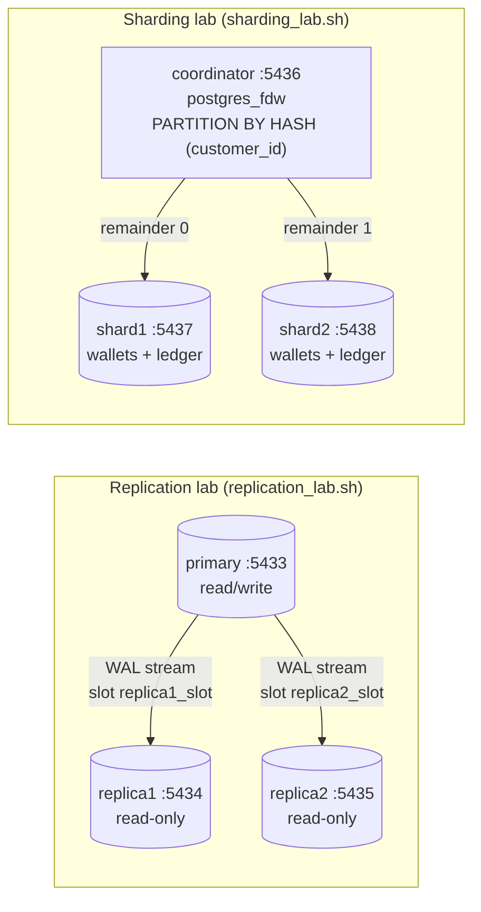
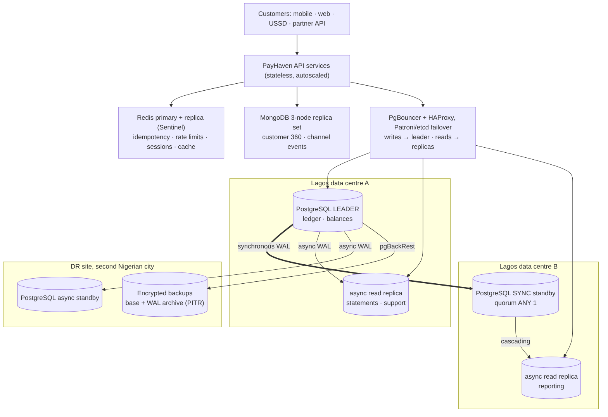

# Portfolio 5 — Distributed and Cloud Database Exercise

**Case study:** PayHaven (see Portfolio 1). **DBMS:** PostgreSQL 16 (streaming replication, `postgres_fdw`, two-phase commit).

A single database server is a single point of failure, and it eventually becomes a single point of congestion too. This portfolio **builds real multi-node PostgreSQL clusters** and measures what distribution buys and what it costs. It then turns those findings into a production cloud design for PayHaven that complies with Nigerian regulation.



| Lab | Script | Evidence |
|---|---|---|
| Replication, consistency, availability, failover (3 nodes) | [`lab/replication_lab.sh`](lab/replication_lab.sh) | [`evidence/replication_lab.txt`](evidence/replication_lab.txt) |
| Sharding and distributed transactions (3 nodes) | [`lab/sharding_lab.sh`](lab/sharding_lab.sh) | [`evidence/sharding_lab.txt`](evidence/sharding_lab.txt) |

Both labs load the real PayHaven schema and Portfolio 3's transfer functions, so the experiments move money with the same code as the rest of the portfolio.

---

## Part A — Replication

### D1. Building the cluster
The primary runs with `wal_level = replica`. Each replica is cloned with `pg_basebackup -R`, which copies the data files, writes `standby.signal` and `primary_conninfo`, and creates a **replication slot** so the primary keeps WAL until that replica has received it. The replicas then stream the primary's **write-ahead log** and replay it. This is *physical* replication: byte-for-byte copies of the whole cluster.

### D2. Read scaling
A ₦15,000 transfer committed on the primary was visible on both replicas within 0.5 s, and `pg_is_in_recovery()` returned `t` on each replica. A transfer attempted on replica1 failed with `cannot execute INSERT in a read-only transaction`. Replicas serve **reads only**, which makes them a good fit for statements, support screens and Portfolio 2's Q8-style reports. That takes load off the primary but doesn't scale **writes**.

### D3. Replication lag means stale reads
Replay on replica1 was paused to simulate a lagging replica, then ₦25,000 was transferred:

| Node | Balance of 4000000001 |
|---|---:|
| primary | 60,000.00 |
| **replica1 (lagging)** | **85,000.00**: stale |
| replica2 | 60,000.00 |

`pg_stat_replication` showed replica1 **4,760 bytes behind** (`replay_lsn < sent_lsn`). After replay resumed, it caught up to 60,000. This is **eventual consistency**. A customer who transfers money and is then routed to a lagging replica sees their *old* balance. PayHaven's rule follows from this: **balance checks and anything after a write read from the primary** ("read-your-writes"). Replicas only serve views that can tolerate slightly old data.

### D4. Consistency vs latency: synchronous replication
`pgbench`, 1 client, 8 s, each transaction a real `deposit()` call:

| Mode | Commit waits for | Avg latency | TPS |
|---|---|---:|---:|
| Asynchronous | Local WAL flush only | 0.985 ms | 1,015 |
| `synchronous_commit = on` | Replica1 has **flushed** the WAL to disk | 1.672 ms | 598 |
| `synchronous_commit = remote_apply` | Replica1 has **applied** it (readable there) | 1.654 ms | 605 |

Synchronous commit cost **about 70% more latency, even with all nodes on one machine**. Across cloud zones the gap widens by an inter-zone round trip on every commit. In return, no committed transfer can be lost if the primary fails (RPO = 0). `remote_apply` also makes the replica safe for read-your-writes.

### D4b. Availability: the CAP trade-off, observed
With `synchronous_standby_names = 'FIRST 1 (replica1)'`, replica1 was stopped and a transfer was committed:
- The session **hung**. `pg_stat_activity` showed `wait_event = SyncRep`.
- After an operator cancelled the wait, the client received: `WARNING: canceling wait for synchronous replication … The transaction has already committed locally, but might not have been replicated to the standby.`

During a partition the primary chose **consistency over availability**: it refused to confirm commits it couldn't replicate. Note also that the "cancelled" transaction *was* committed locally, so an application must treat that warning as an **unknown outcome** and check the idempotency reference (Portfolio 3), not blindly retry.

**Fix: quorum commit.** With `synchronous_standby_names = 'ANY 1 (replica1, replica2)'`, the same transfer committed in **57 ms** while replica1 was still down, because replica2 acknowledged it (`sync_state = quorum`). This keeps RPO = 0 and survives the loss of any one replica.

### D5. Failover and rejoin
| Step | Time |
|---|---:|
| Primary killed (`pg_ctl stop -m immediate`, simulating a crash) | t = 0 |
| `pg_promote()` on replica2 completes | **217 ms** |
| First successful transfer on the new primary | **234 ms** |

- **RPO:** 0 transactions lost (17,756 before the crash, all present on replica2). With asynchronous replication, commits that hadn't streamed yet *could* be lost. With synchronous or quorum replication they cannot.
- **RTO:** 234 ms is the *database* part only, with a human-free script. Production failover also includes detection (health-check timeouts, typically 10–30 s) and re-routing clients. That's what Patroni and HAProxy automate.
- **Rejoin:** replica1 was re-pointed to the new primary and followed its **new timeline (TL 2)**. The crashed old primary had WAL the new primary never saw, so it was re-synchronised with **`pg_rewind`** (`wal_log_hints = on` makes this possible) and restarted as a replica. The final topology has replica2 as leader, with `old_primary` and `replica1` both streaming, all on timeline 2 and all with the same balance.

---

## Part B — Sharding and distributed transactions

**Design:** `wallets` and `wallet_ledger` are hash-partitioned on **`customer_id`**. Each partition is a `postgres_fdw` foreign table on a different shard. The coordinator holds no data, only routing metadata. Both tables use the *same* shard key, so a customer's wallet and ledger are always **co-located** on one shard.

### S1. Distribution
20,000 wallets and 100,000 ledger lines were inserted *through the coordinator*, which routed every row (1.1 s). The result was **shard1: 10,023 wallets, shard2: 9,977**. Hashing spreads keys evenly, unlike range sharding on, say, account-opening date, which would put all new and active customers on one hot shard.

### S2. Routing
`WHERE customer_id = 42` gives a plan with **one** `Foreign Scan on wallets_s1` (partition pruning), so only one shard does any work. A query **without** the shard key (`WHERE account_number = …`) becomes an `Append` of `Async Foreign Scan`s on **every** shard. **Choosing the shard key is choosing which queries are cheap.** That's why the API should look accounts up by customer, or keep a small global `account_number → customer_id` directory.

### S3. Co-located join pushdown
The top-5 customers by ledger volume (wallets JOIN ledger) runs as `Relations: (wallets_s1 w) INNER JOIN (wallet_ledger_s1 l)`, and the same on shard2. **Each shard performs the join itself** and ships only results. This works only because both tables are sharded by the same key. Non-co-located joins would have to move rows between nodes.

### S4. Scatter-gather aggregation
- **Grouped by the shard key:** `Relations: Aggregate on (wallet_ledger_s1)`. Each shard computes final per-customer totals in parallel (`Async Foreign Scan`).
- **A bank-wide total:** PostgreSQL 16's `postgres_fdw` did not push the partial aggregates down, so each shard shipped every `balance` row to the coordinator. Global analytics on a sharded OLTP cluster is expensive, which is another reason for reporting replicas or a separate analytics warehouse.

### S5. Cross-shard transfer without two-phase commit
A ₦60,000 transfer whose receiver would exceed a shard's ₦150,000 rule (checked at COMMIT):

| Direction | Outcome |
|---|---|
| shard1 customer → shard2 customer | **INCONSISTENT**: shard1's debit committed, shard2's credit failed. **₦60,000 vanished** (total 200,000 → 140,000) |
| shard2 customer → shard1 customer | Consistent: the failing shard happened to commit first, so both rolled back |

`postgres_fdw` commits each shard one after another. When a *later* shard fails, an *earlier* one has already committed and can't be undone. **Atomicity across nodes is not free.** Whether money disappears depends on commit order, which is exactly the kind of non-deterministic bug that reaches production.

### S6. Two-phase commit (2PC)
The coordinator first asks every shard to `PREPARE TRANSACTION`. That makes the shard durably promise it *can* commit, after checking all deferred constraints. Only then does it send `COMMIT PREPARED`.

| Case | Phase 1 | Phase 2 | Result |
|---|---|---|---|
| ₦30,000 transfer | Both shards voted YES | COMMIT PREPARED on both | 70,000 + 130,000 = **200,000** ✅ |
| ₦60,000 more (would break shard2's limit) | shard1 YES, **shard2 NO** | ROLLBACK PREPARED on shard1 | Unchanged, **200,000** ✅ |
| Coordinator "crashes" between phases | Both prepared | No decision sent | `pg_prepared_xacts` shows `xfer-003` **in doubt** on both shards. A local payment by the same customer **timed out waiting for the lock**. After the coordinator recovers and commits, total = **200,000** ✅ |

**2PC gives atomicity but is a *blocking* protocol.** While the coordinator is down, prepared transactions hold their locks indefinitely. Production systems therefore need a durable coordinator decision log and automatic recovery. Distributed SQL databases (Citus, CockroachDB, Spanner) build this in. Many payment systems instead **avoid cross-shard ACID**: they use a **saga with an outbox**, debiting on shard A, publishing an event, crediting on shard B, and running a compensating refund if the credit fails. That gives *eventual* consistency, made safe by the idempotency keys from Portfolio 3.

---

## Part C — Production cloud design for PayHaven



### C1. Regulatory constraint: the data must stay in Nigeria
- In a circular dated **15 June 2026**, the CBN directed institutions facilitating payments in Nigeria to host and manage payment transaction data domestically, with **full compliance required by 1 January 2027**.<sup>[1]</sup><sup>[2]</sup> The requirement is framed around *payment transaction data generated in Nigeria*, not every category of data.<sup>[3]</sup>
- The **Nigeria Data Protection Act 2023** (sections 41–43) allows personal data to leave Nigeria only with an adequacy decision, an NDPC-approved transfer instrument, or another lawful basis under section 43, and section 41(2) requires the basis for each transfer to be recorded.<sup>[4]</sup><sup>[5]</sup>

**Design consequence:** the PayHaven ledger, its replicas, its backups *and its DR site* are all in Nigeria. A foreign cloud region (Cape Town, Frankfurt) is **not** used for payment data. It could only host non-payment workloads under an NDPA transfer basis. On hosting, AWS has had a **Local Zone in Lagos** since January 2023.<sup>[6]</sup> Local Zones extend a parent region with a subset of services, so the managed-database options there must be checked before relying on them. Nigerian Tier III data centres and local cloud platforms are the other route.<sup>[7]</sup>

### C2. Topology (justified by Parts A and B)
| Component | Placement | Why (evidence) |
|---|---|---|
| PostgreSQL **leader** | Lagos DC A | Single writer for the ledger (P3 row locks need one authority) |
| **Synchronous standby**, quorum `ANY 1 (dcB_standby, dr_standby)` | Lagos DC B + DR site | RPO = 0 (D4), and surviving one replica's loss without blocking commits (D4b) |
| Async **read replicas** | DC A (statements, support), DC B (reporting) | Read scaling (D2). Never used for balance checks (D3) |
| **DR standby** | Second Nigerian city | Survives a whole-site or metro outage while staying in-country (C1) |
| **Patroni + etcd** (3 voters across sites) + **HAProxy/PgBouncer** | All sites | Automates D5: detection, promotion, rerouting, `pg_rewind` rejoin. A majority vote avoids **split-brain** (two leaders) |
| **pgBackRest**: nightly base backup + continuous WAL archive, encrypted | In-country object storage | **Point-in-time recovery**. Replication copies mistakes instantly (a bad `UPDATE` reaches every replica in milliseconds), and only backups can undo them |
| **Redis** primary + replica + Sentinel | DC A / DC B | Portfolio 4 patterns. `noeviction` for limiters and idempotency keys |
| **MongoDB** 3-node replica set, `w: majority` | DC A / DC B / DR | Portfolio 4 read models, fed by change data capture from PostgreSQL |

### C3. Targets
| Metric | Target | How |
|---|---|---|
| **RPO** (data loss on failure) | 0 for the ledger | Quorum synchronous replication (D4/D4b) |
| **RTO** (time to recover) | < 1 minute automatic within Lagos; < 30 minutes for a full site failover | Patroni (D5 shows promotion itself is sub-second) |
| Backup recovery | Any point in the last 35 days | WAL archive + base backups. Restores tested monthly |
| Read capacity | Scale out with replicas | D2 |

### C4. When to shard, and how
Vertical scaling plus read replicas will carry PayHaven a long way: Portfolio 2 showed indexed OLTP queries in under 1 ms on 2.4M ledger rows. Shard only when **write** throughput or data size outgrows one leader. When that happens:
- **Shard key = `customer_id`**, co-locating each customer's accounts, ledger and beneficiaries (S2, S3).
- Use a system with built-in distributed transactions (for example **Citus** on PostgreSQL, which uses 2PC internally), or move cross-customer transfers to a **saga + outbox** with idempotent steps (S5, S6).
- **Fix the GL hot spot first** (Portfolio 3, E6): split the settlement and fee GL rows into N sub-accounts, or post GL entries asynchronously. Otherwise every shard funnels through one row.
- Hash partitioning with a fixed modulus makes **resharding** expensive (going from 2 to 4 shards moves data). Plan with more logical partitions than physical nodes, for example 32 partitions spread over 2 nodes, so growth means moving partitions rather than rehashing rows.

### C5. CAP / PACELC summary for each PayHaven store
| Store | During a partition (CAP) | Normal operation (PACELC: Latency vs Consistency) |
|---|---|---|
| PostgreSQL ledger (quorum sync) | **CP**: blocks commits rather than risk losing them (D4b) | Pays commit latency for consistency (D4) |
| PostgreSQL read replicas | Serve possibly stale data | Low latency, eventually consistent (D3) |
| MongoDB read models (`w: majority`) | CP for writes. Secondaries may serve stale reads | Eventually consistent copy of PostgreSQL via CDC |
| Redis (async replica) | AP-leaning: a failover can drop recent writes | Lowest latency. Never the source of truth for money |

---

## How to run the labs yourself

They need **Linux, macOS or WSL on Windows** with PostgreSQL 16 server binaries, and must run as a normal (non-root) user.

```bash
# Ubuntu / WSL
sudo apt install postgresql-16 bc        # postgres_fdw ships with the server package
sudo systemctl stop postgresql          # optional: the labs use their own ports 5433-5438
cd portfolio-5-distributed-cloud/lab
./replication_lab.sh | tee ../evidence/replication_lab.txt     # ~40 s
./sharding_lab.sh    | tee ../evidence/sharding_lab.txt        # ~20 s
```
Each script builds fresh clusters under `/tmp`, runs every experiment, and stops the nodes at the end. Timings will differ slightly on your machine.

## Sources
1. [Techpoint Africa — CBN data localisation push raises concerns](https://techpoint.africa/insight/cbn-data-localisation-push-raises-concerns/) (circular of 15 June 2026)
2. [TechCabal — Nigeria's data centres face major test under CBN's local hosting mandate](https://techcabal.com/?p=191875) (deadline 1 January 2027)
3. [Youverify — CBN payment data storage regulations](https://youverify.co/en/blogs/cbn-payment-data-storage-regulations-data-localisation-nigeria) (scope: payment transaction data)
4. [ALN — What constitutes cross-border transfer of personal data?](https://aln.africa/?p=7017) (NDPA ss. 41–43, GAID 2025)
5. [Lineserve — Data localisation in Nigeria](https://www.lineserve.net/blog/data-localisation-in-nigeria) (NDPA s. 41(2) record-keeping)
6. [Connecting Africa — Lagos launches first AWS Local Zone in Africa](https://connectingafrica.com/cloud-networking/lagos-launches-first-aws-local-zone-in-africa) (January 2023)
7. [TechEconomy — Clouds2Africa and the CBN localisation deadline](https://techeconomy.ng/clouds2africa-positions-for-cbn-data-localisation-deadline) (in-country Tier III hosting)
